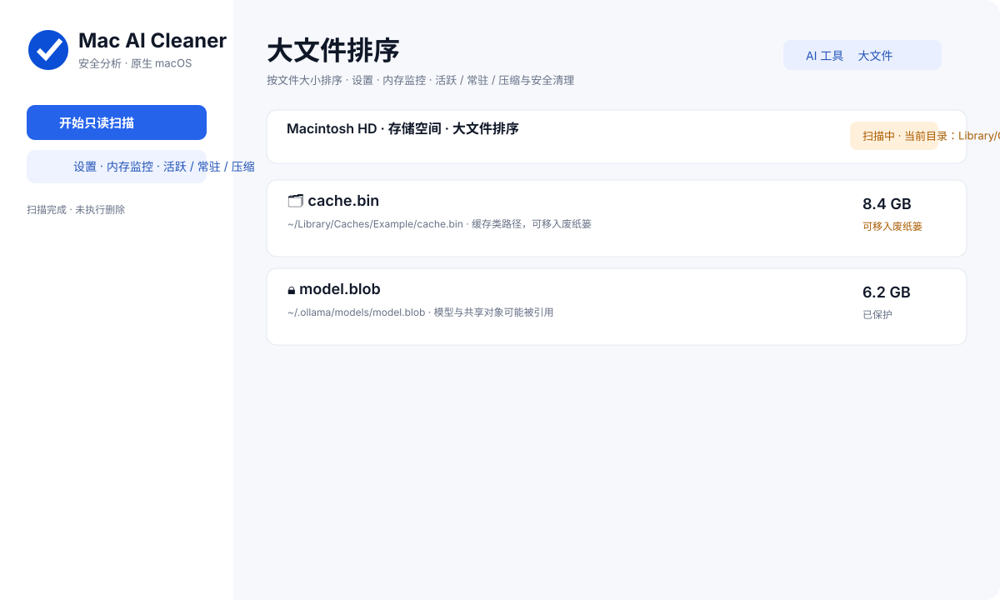
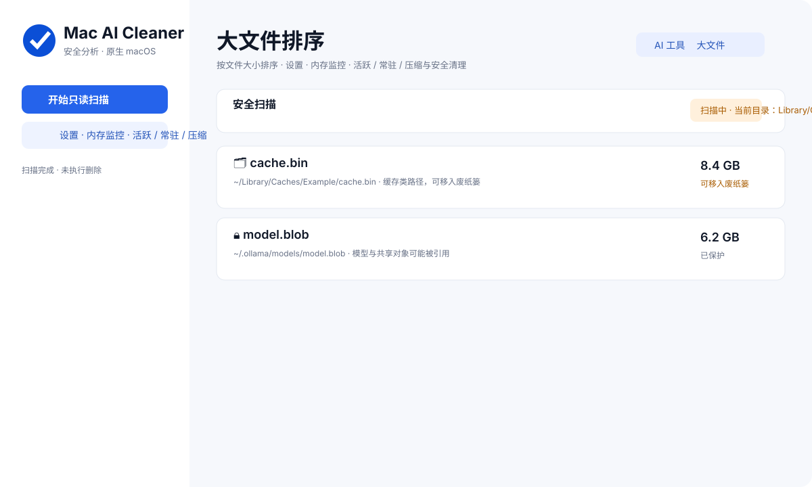
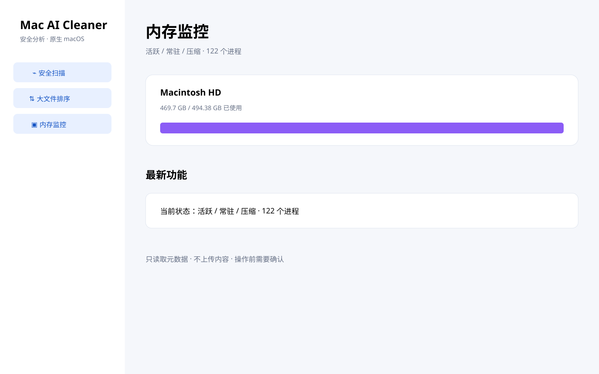
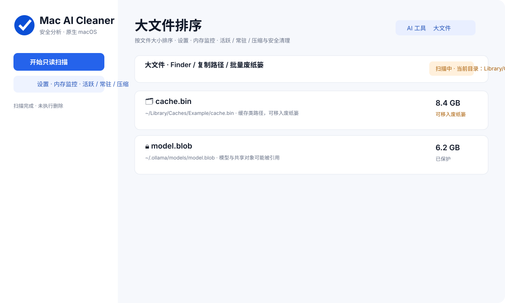

# 🧹 Mac AI Cleaner

[English README](README.md)

Mac AI Cleaner 是一款强调安全边界的 macOS AI 工具与垃圾分析器。它会自动检查用户目录、`Application Support`、缓存目录、用户应用目录以及工具通过环境变量指定的位置，因此不要求每个人都使用默认路径。

## 功能

- 自动发现自定义 AI 工具目录，不只检查默认路径。
- 分析 AI IDE、Agent、CLI、本地模型、桌面客户端和开发工具。
- 对缓存和垃圾候选展示大小、用途、风险、影响和恢复条件。
- 对系统大文件进行大小排序，支持单独的大文件分析入口。
- 内存监控：显示总内存、已用内存、可用内存和可读取到的高占用程序。
- 清理采用二次确认，经过策略审核的缓存只移动到 macOS 废纸篓。
- 当前安全垃圾规则覆盖用户缓存、`~/.cache`、npm 缓存和可重建开发缓存；会话、凭证、模型、项目和未知数据继续保护。
- 大文件工作区按大小排序，并明确区分受保护项目和可恢复缓存。
- 增加磁盘管理式容量环、扫描范围与进度、在访达中显示、多选和批量移到废纸篓。
- 内存监控显示总量、已用、可用、进度条及系统允许读取的高占用程序。
- 扫描、 大文件、内存和设置都在右侧主面板切换，设置页包含语言控制。
- 大文件默认只扫描用户缓存和下载目录，不访问日历、通讯录或系统目录。
- 内存监控显示已用、可用、活跃、常驻、压缩内存、压力、RSS、虚拟内存、PID 和线程数。
- 每个大文件条目都支持在访达中显示和复制路径；批量清理只有成功进入废纸篓的项目才会从列表移除。

## 安全边界

未知目录、系统文件、项目源代码、凭证、Token、会话、Skills、MCP、配置、Git Worktree 和模型文件默认保护。程序不会使用通用 `sudo rm -rf`，也不会上传文件内容。清理执行前会再次校验路径和安全策略。

## 编译、测试和打包

```sh
# Debug 编译
swift build

# 运行 App 和只读 CLI
swift run MacAICleaner
swift run cleaner-scan --redact
swift run cleaner-scan --memory

# 运行 XCTest（需要完整 Xcode）
swift test

# Release 编译
swift build -c release

# 生成可安装 App 和 zip
./scripts/package_app.sh
```

打包脚本会生成 `dist/MacAICleaner.app` 和 Apple Silicon zip。没有 Developer ID 时使用 Ad Hoc 签名；正式发布还需要签名和公证。应用内的内存监控页面支持中文/English 切换，扫描报告支持导出脱敏 JSON。

## 当前版本

这是安全优先的 Alpha 版本。扫描和分析能力已实现；完整的跨 macOS 版本、Intel / Apple Silicon、签名、公证及所有真实工具适配器仍需持续验证。



## 截图

### 存储概览和大文件


### 安全扫描



### 内存监控



### 访达操作和清理



## 0.2.0 版本说明

- 只读 AI 工具发现和保护路径规则。
- 系统存储风格概览与大文件排序。
- 在访达中显示、复制路径、多选和可恢复废纸篓清理。
- 内存压力、活跃/常驻/压缩内存、RSS、虚拟内存、PID 和线程详情。
- 中英文文档和设置页语言选择。
